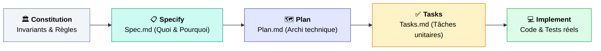

---
# try also 'default' to start simple
theme: seriph
# random image from a curated Unsplash collection by Anthony
# like them? see https://unsplash.com/collections/94734566/slidev
background: https://cover.sli.dev
# some information about your slides (markdown enabled)
title: MODULE 4 — Les 4 patrons de conception agentiques
info: |
  ## Cours Agentic AI 
# apply UnoCSS classes to the current slide
class: text-center
# https://sli.dev/features/drawing
pdf: true
export: true
drawings:
  persist: false
# slide transition: https://sli.dev/guide/animations.html#slide-transitions
transition: slide-left
# enable Comark Syntax: https://comark.dev/syntax/markdown
comark: true
# duration of the presentation
duration: 35min
---


# Module 6 : Agents pour le Dév Logiciel
## Du copilote d'autocomplétion aux agents autonomes d'ingénierie

<div class="pt-12">
  <span class="px-3 py-1 rounded bg-emerald-600/60 text-sm font-mono">Génie Logiciel Augmenté & Spec-Driven Development</span>
  <p class="mt-4 text-gray-300 text-sm">Industrialiser la production de code avec Claude Code, Spec-Kit, SWE-bench et CI/CD</p>
</div>

---
layout: default
---

# 1. Du Copilote à l'Agent Autonome

Une rupture de paradigme dans la façon d'interagir avec la base de code :

<div class="grid grid-cols-2 gap-6 mt-6 text-xs">

<div class="p-4 border rounded-xl bg-gray-50 dark:bg-gray-800">
  <div class="text-emerald-500 font-bold text-sm mb-2">Génération 1 : Le Copilote (2021-2023)</div>
  <div class="text-gray-400 italic mb-3">GitHub Copilot Inline, Codeium</div>
  <ul class="space-y-2">
    <li>• <b>Rôle :</b> Autocomplétion statistique au fil du curseur (*Ghost text*).</li>
    <li>• <b>Portée :</b> Limitée au fichier en cours d'édition (quelques dizaines de lignes).</li>
    <li>• <b>Action :</b> Aucune autonomie ; c'est le développeur qui navigue, compile et teste.</li>
    <li>• <b>Statut :</b> Simple accélérateur de saisie clavier.</li>
  </ul>
</div>

<div class="p-4 border-2 border-emerald-500 rounded-xl bg-emerald-50 dark:bg-emerald-950">
  <div class="text-emerald-600 font-bold text-sm mb-2">Génération 2 : L'Agent de Code (2024-2026)</div>
  <div class="text-gray-400 italic mb-3">Claude Code, OpenHands, Cursor Agent, Devin</div>
  <ul class="space-y-2">
    <li>• <b>Rôle :</b> Ingénieur en binôme orienté résolution de tâche (*Task-driven*).</li>
    <li>• <b>Portée :</b> Répertoire complet (recherche de symboles, analyse du graphe de dépendances).</li>
    <li>• <b>Action :</b> Modifie plusieurs fichiers, lance les compilateurs, lit les erreurs et itère.</li>
    <li>• <b>Statut :</b> Opérateur de modifications logicielles avec effets de bord.</li>
  </ul>
</div>

</div>

<div class="mt-4 p-2 bg-gray-100 dark:bg-gray-800 rounded text-center text-xs">
  ⚠️ <b>Attention au "Vibe Coding" :</b> Laisser un agent coder sans méthode mène à une dette technique ingérable. Le génie logiciel exige du cadre.
</div>

---
layout: default
---

# 2. La Réponse au Chaos : Spec-Driven Development (SDD)

Le *Vibe Coding* (prompter et prier) échoue sur les gros projets. Le **SDD** rétablit la hiérarchie logicielle.

<div class="grid grid-cols-2 gap-6 mt-4 items-center">
<div>

### La fin du code "roi"
- **Historiquement :** Le code source était la seule vérité ; les specs et tickets Jira devenaient obsolètes dès le premier commit.
- **En SDD :** **La spécification redevient la source de vérité exécutable.**
- Le modèle ne génère pas de code directement depuis une consigne vague : il génère et raffine d'abord la spécification formelle, puis le code en découle mécaniquement.

</div>

<div class="p-4 bg-gray-50 dark:bg-gray-800 border-l-4 border-emerald-500 rounded text-xs space-y-2">
  <div class="font-bold text-emerald-600 text-sm">Le principe fondateur de l'approche SDD :</div>
  <p class="italic text-gray-600 dark:text-gray-300">
    « For decades, code was king. SDD inverts this power structure: specifications don't serve code, code serves specifications. »
  </p>
  <div class="pt-2 text-[11px] text-gray-500">
    En cadrant l'espace de décision avant l'implémentation, on supprime 90% des hallucinations d'architecture.
  </div>
</div>
</div>

---
layout: default
---

# 3. GitHub Spec-Kit : Un exemple de Framework orienté SDD

Toolkit open source (Microsoft/GitHub) standardisant le SDD pour Claude Code, Copilot et Cursor.

<div class="mt-2 flex justify-center [&>svg]:max-w-4xl">



</div>

<div class="grid grid-cols-4 gap-3 mt-4 text-xs">
  <div class="p-2 border rounded bg-gray-50 dark:bg-gray-800">
    <b>1. Constitution :</b> Stack imposée, règles de sécurité, conventions de nommage, bibliothèques interdites.
  </div>
  <div class="p-2 border rounded bg-gray-50 dark:bg-gray-800">
    <b>2. Specify :</b> User stories, cas limites, critères d'acceptation formels (Gherkin/Given-When-Then).
  </div>
  <div class="p-2 border rounded bg-gray-50 dark:bg-gray-800">
    <b>3. Plan :</b> Schéma de base de données, contrats d'API, arborescence des fichiers modifiés.
  </div>
  <div class="p-2 border rounded bg-gray-50 dark:bg-gray-800">
    <b>4. Tasks :</b> Découpage en 15 micro-tâches ordonnancées cochables au fur et à mesure.
  </div>
</div>

---
layout: default
---

# Démo Pratique Spec-Kit : Le cycle de vie en CLI

Comment le développeur pilote l'agent à travers des contrats d'artefacts[[7](https://www.google.com/url?sa=E&q=https%3A%2F%2Fvertexaisearch.cloud.google.com%2Fgrounding-api-redirect%2FAUZIYQE2LvzX9TgCeE35GdwYWCgnRx16ZfjuEwJfDH6yThVvP_xVmIQ6zfdM5gwwJAH_g8c92_upHHH8RksO-rsuqI_cE6eYo98-9E0d5iP4-1L-B8PdjZ7wNPOaR3Ixd7VbEcWDKpMaqoDGPzYC3TjJKnUhN2QRRlcHO9QcnaomBw%3D%3D)] :

```bash
# 1. Initialisation du projet et injection des règles non-négociables
$ uvx --from git+https://github.com/github/spec-kit.git specify init MonProjet
```

<div class="mt-3 p-3 bg-gray-900 text-gray-100 rounded-lg font-mono text-[11px] leading-relaxed">
  <div class="text-gray-400">// Dans l'agent CLI (Claude Code, Gemini CLI, Cursor) :</div>
  <div class="text-emerald-400">/speckit-constitution</div>
  <div class="text-gray-300">"Stack : Python 3.12, FastAPI, SQLAlchemy async, interdiction de toucher au schéma auth sans review."</div>

  <div class="text-emerald-400 mt-2">/speckit-specify "Ajouter un rate-limiter par IP sur l'endpoint /api/v1/search"</div>
  <div class="text-gray-300">-> Génère .specify/spec.md avec gestion des en-têtes Retry-After et cas limites Redis indisponible.</div>

  <div class="text-emerald-400 mt-2">/speckit-plan && /speckit-tasks</div>
  <div class="text-gray-300">-> Génère le plan d'architecture puis le découpage en 4 tâches unitaires dans tasks.md.</div>

  <div class="text-emerald-400 mt-2">/speckit-implement</div>
  <div class="text-gray-300">-> L'agent prend la tâche 1, écrit le test unitaire, écrit le middleware, fait passer pytest, coche la tâche.</div>
</div>

---
layout: default
---

# 4. Résolution Autonome de Bugs & SWE-bench

Résoudre un vrai bug logiciel ne consiste pas à inventer du code, mais à **naviguer et diagnostiquer**.

<div class="grid grid-cols-2 gap-6 mt-4 text-xs">
<div>

### La démarche d'un agent de maintenance :
1. **Localisation du défaut (Fault Localization) :**  
   Utiliser `grep`, `find`, ou l'AST pour identifier le fichier incriminé parmi des milliers.
2. **Reproduction du bug (Test-First) :**  
   Écrire un test unitaire qui échoue (*Red*) reproduisant fidèlement le rapport de bug de l'Issue.
3. **Application du patch minimal :**  
   Modifier uniquement les lignes nécessaires sans introduire de régression collatérale.
4. **Vérification de la suite de tests :**  
   Exécuter les tests locaux pour s'assurer que le test ciblé passe au vert (*Green*).

</div>

<div>

### Le juge de paix : SWE-bench
- **Corpus :** 2 294 problèmes logiciels réels extraits de dépôts GitHub open-source célèbres (Django, SymPy, scikit-learn).
- **Entrée de l'agent :** Le dépôt git + le texte exact de l'Issue GitHub.
- **Critère de succès :** Le patch généré par l'agent fait passer les tests cachés créés par les mainteneurs du projet.
- **Progression fulgurante :**
  - Fin 2023 : ~4% de résolution
  - 2025-2026 : >50% à 75% avec les modèles de raisonnement récents.

</div>
</div>

---
layout: default
---

# 5. Tests Générés par Agents : Vers le Mutation Testing

Écrire des tests ne sert à rien si le test valide un code déjà erroné par complaisance.

<div class="grid grid-cols-3 gap-4 mt-6 text-xs">

<div class="p-3 border rounded bg-gray-50 dark:bg-gray-800">
  <div class="font-bold text-emerald-500 text-sm mb-1">1. Tests Unitaires & Cas Limites</div>
  L'agent excelle pour générer des jeux de données aux limites :
  - Tableaux vides, entiers négatifs, valeurs nulles, caractères UTF-8 exotiques.
  - Mock des dépendances réseau et bases de données.
</div>

<div class="p-3 border rounded bg-gray-50 dark:bg-gray-800">
  <div class="font-bold text-indigo-500 text-sm mb-1">2. Tests de Non-Régression</div>
  À partir d'une trace d'erreur de production (Sentry, logs Datadog) :
  - L'agent transforme l'erreur en un test de non-régression automatisé avant d'appliquer le correctif.
</div>

<div class="p-3 border-2 border-emerald-500 rounded bg-emerald-50 dark:bg-emerald-950">
  <div class="font-bold text-emerald-600 text-sm mb-1">3. Test de Mutation (Le Graal)</div>
  Pour valider la solidité des tests créés par l'agent :
  - On injecte délibérément des mutations dans le code source (`>` remplacé par `>=`, `true` par `false`).
  - Si les tests de l'agent ne détectent pas le mutant, le test est considéré comme inutile et rejeté.
</div>

</div>

---
layout: two-cols-header
---

# 6. Revue de Code & Refactoring Automatisé

Transformer l'agent en relecteur impartial et impitoyable de Pull Requests.

::left::
### Au-delà du linter classique
Un linter (`eslint`, `ruff`) vérifie la syntaxe. L'agent comprend la sémantique :
- **Détection des failles OWASP :** Injections SQL cachées, failles de désérialisation, secrets commis par erreur.
- **Invariants d'architecture :** Détecter une violation de couche (*ex: un contrôleur web qui importe directement le driver SQL*).
- **Détection de code mort ou dupliqué :** Suggérer une factorisation élégante.

::right::
<div class="ml-4 p-3 bg-gray-900 text-gray-100 rounded font-mono text-[11px] leading-relaxed">
  <div class="text-rose-400 font-bold">⚠️ CRITIQUE AGENT SUR LA PR #128 :</div>
  <br/>
  "Fichier <code class="text-red">billing.py</code>, ligne 45 :<br/>
  Vous effectuez un appel HTTP synchrone vers Stripe à l'intérieur d'une transaction de base de données ouverte.<br/><br/>
  <b>Risque :</b> En cas de lenteur chez Stripe, le verrou SQL sera maintenu et saturera le pool de connexions.<br/><br/>
  <b>Correction proposée :</b> Sortir l'appel Stripe avant le bloc <code class="text-red">async with db.transaction():</code>."
</div>

---
layout: default
---

# 7. Documentation & Onboarding d'une Codebase

Résoudre le cauchemar du développeur arrivant sur un projet legacy de 500 000 lignes non documenté.

<div class="grid grid-cols-2 gap-6 mt-4 text-xs">
<div>

### Reverse-Engineering d'Architecture
- L'agent scanne le dépôt, trace les imports et génère des diagrammes d'architecture à jour (Mermaid, C4 Model).
- Explication vulgarisée : *« Quel est le chemin critique suivi par une requête de paiement entre l'API Gateway et la comptabilité ? »*

### Documentation "Vivante"
- Génération automatique de spécifications OpenAPI synchronisées avec le code.
- Création de `README.md` et de guides de contribution réels testés par l'agent lui-même (l'agent joue le rôle du nouvel arrivant et tente de compiler le projet).

</div>

<div class="p-4 border rounded-xl bg-gray-50 dark:bg-gray-800">
  <div class="font-bold text-emerald-500 mb-2">L'agent comme tuteur de codebase</div>
  <p class="text-gray-500 italic">
    « Tu es un nouvel ingénieur junior. Interroge l'agent sur l'historique du projet. »
  </p>
  <div class="mt-3 p-2 bg-white dark:bg-gray-900 rounded font-mono text-[10px]">
    <b>Dev :</b> "Pourquoi utilise-t-on deux ORM différents dans ce repo ?"<br/><br/>
    <b>Agent :</b> "D'après les commits git de mars 2024, une migration de Django ORM vers SQLAlchemy a été initiée pour le service analytique mais interrompue. Les modules X et Y sont les seuls sur SQLAlchemy."
  </div>
</div>
</div>

---
layout: default
---

# 8. CI/CD & Pipelines Agentiques : L'Usine Logicielle

Déplacer l'agent du terminal local vers les workflows d'automatisation GitHub Actions / GitLab CI.

```mermaid {scale: 0.6}
flowchart LR
    A["Dev Push Commit"] --> B["Pipeline CI (Build & Tests)"]
    B -- "❌ Échec Build" --> C["🤖 Agent Auto-Fixer"]
    C --> D["Analyse du log d'erreur"]
    D --> E["Création d'un patch correctif"]
    E --> F["Re-jeu de la CI"]
    F -- "✅ Succès" --> G["PR automatique ou Merge"]

    style A fill:#f1f5f9,stroke:#64748b,color:#000
    style B fill:#fee2e2,stroke:#ef4444,color:#000
    style C fill:#ccfbf1,stroke:#0d9488,color:#000
    style G fill:#dcfce7,stroke:#16a34a,color:#000
```

<div class="mt-2 flex justify-center [&>svg]:max-w-4xl">



</div>

<div class="grid grid-cols-3 gap-3 mt-4 text-xs">
  <div class="p-2 border rounded bg-gray-50 dark:bg-gray-800">
    <b>Self-Healing CI :</b> Si une dépendance casse le build à cause d'un changement de typage, l'agent crée la PR corrective dans les 2 minutes.
  </div>
  <div class="p-2 border rounded bg-gray-50 dark:bg-gray-800">
    <b>Migration de versions :</b> Mise à niveau automatique d'un framework (ex: Java 17 ➔ Java 21) avec réécriture syntaxique des dépréciations.
  </div>
  <div class="p-2 border rounded bg-gray-50 dark:bg-gray-800">
    <b>Triage d'Issues :</b> Qualification automatique des bugs soumis par les utilisateurs, reproduction via script et ajout d'étiquettes de priorité.
  </div>
</div>

---
layout: default
---

# 9. Bonnes Pratiques, Garde-fous & Limites

Déléguer du code à des agents exige de nouveaux réflexes de protection logicielle.

<div class="grid grid-cols-2 gap-6 mt-4 text-xs">

<div class="p-3 border rounded bg-gray-50 dark:bg-gray-800">
  <div class="font-bold text-amber-500 text-sm mb-2">🛡️ Les Garde-Fous Indispensables</div>
  <ul class="space-y-2">
    <li>• <b>Pas de merge sans validation humaine (Human-in-the-loop) :</b> Aucune PR d'agent ne doit être mergée en production sans revue par un ingénieur senior.</li>
    <li>• <b>Environnements éphémères jetables :</b> Les tests exécutés par l'agent doivent tourner dans des conteneurs sans accès au réseau corporate.</li>
    <li>• <b>Isolation des secrets :</b> L'agent n'a pas besoin des credentials de production pour coder (utiliser des mocks stricts).</li>
  </ul>
</div>

<div class="p-3 border rounded bg-gray-50 dark:bg-gray-800">
  <div class="font-bold text-rose-500 text-sm mb-2">⚠️ Les Pièges & Coûts Cachés</div>
  <ul class="space-y-2">
    <li>• <b>La Dette Technique Fantôme :</b> Le code généré par IA est souvent verbeux et redondant. Le coût de maintenance à 3 ans explose si personne ne le comprend.</li>
    <li>• <b>L'Atrophie des Compétences :</b> Si les juniors ne codent plus les bases, comment formeront-ils les seniors de demain ?</li>
    <li>• <b>Coût d'inférence en boucle :</b> Un agent qui tourne en boucle sur un bug pendant 45 min peut consommer 30€ de tokens pour une faute de frappe.</li>
  </ul>
</div>

</div>

---
layout: default
---

# Synthèse du Module 6

<div class="p-5 bg-emerald-50 dark:bg-emerald-950 border border-emerald-500 rounded-xl space-y-3">
  <div class="font-bold text-emerald-600 text-lg">À retenir pour les équipes d'ingénierie :</div>
  <ul class="text-sm space-y-2">
    <li><b>Abandonner le Vibe Coding :</b> Structurer les requêtes via le <i>Specification-Driven Development</i> (Spec-Kit) pour garantir la maintenabilité.</li>
    <li><b>L'Agent est un opérateur, pas un architecte :</b> Le développeur cadre l'intention, l'agent exécute les tâches unitaires et soumet des patchs vérifiables.</li>
    <li><b>Le test unitaire est le contrat absolu :</b> La seule façon de faire confiance à un agent est de lui imposer une suite de tests rigoureuse (SWE-bench method).</li>
    <li><b>Intégration CI/CD :</b> Le futur de l'agentique logicielle réside dans la maintenance continue automatisée supervisée par des humains.</li>
  </ul>
</div>

---
layout: end
class: text-center
---

# Fin du Module 6
### Place aux démonstrations live (Spec-Kit & Claude Code) !

[GitHub Spec-Kit](https://github.com/github/spec-kit) · [SWE-bench Benchmark](https://www.swebench.com)